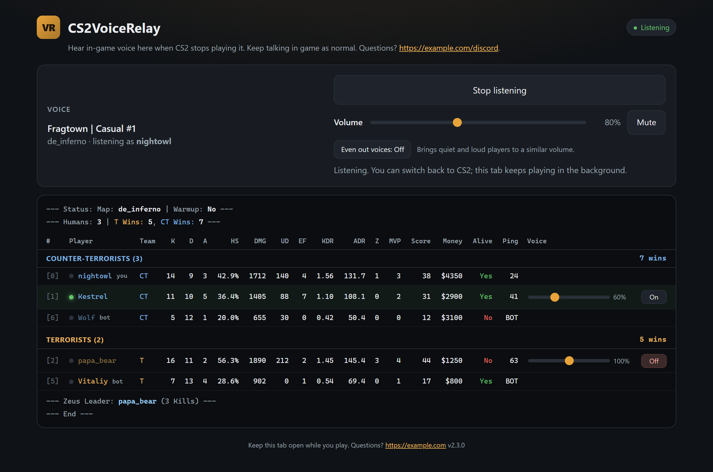
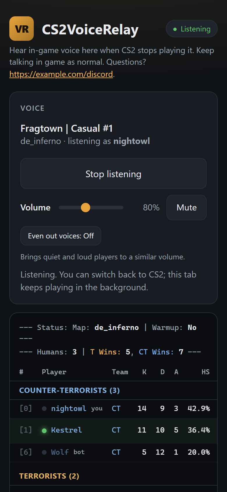
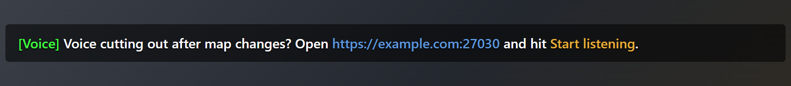
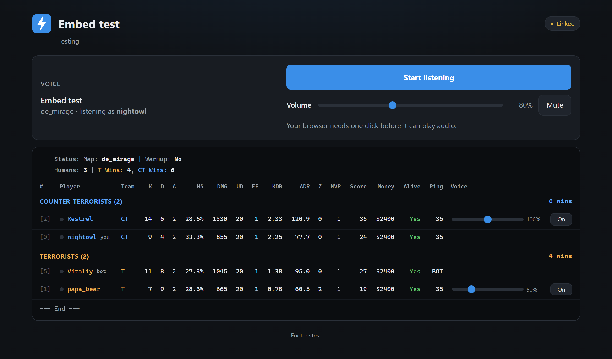
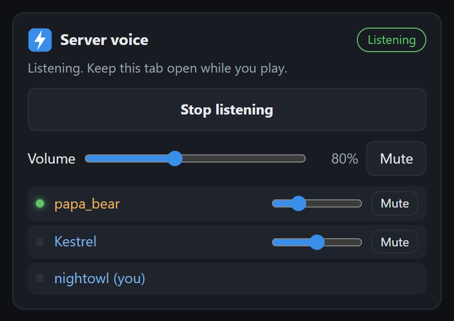
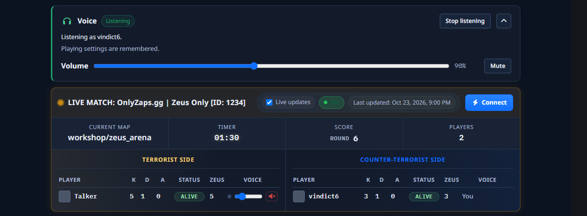

# CS2VoiceRelay

Hear in-game voice in your browser. Comes with a live scoreboard.

> If you like this and it's useful on your server, please consider supporting it:
> [buymeacoffee.com/theboneman](https://buymeacoffee.com/theboneman). It keeps me building and
> fixing stuff like this. Thank you!



## Why I made this

CS2 has a client bug where in-game voice just stops working after a Workshop map unloads.
Switch between Workshop maps, rejoin a server that's on one, or go back to a stock map, and you
can't hear anybody until you restart the game. Valve's been tracking it since January 2025
([csgo-osx-linux#3980](https://github.com/ValveSoftware/csgo-osx-linux/issues/3980)): the client
deletes the one sound all incoming voice plays through and never makes it again. Nothing a
server sends can fix that, and I tried a lot of things.

Talking still works, though. Only hearing breaks. So I left the mic side alone and fixed the
receiving side: the server streams the voice it would have sent you to a web page you keep open
next to the game.

## What it does

- You talk in game exactly like before, with your normal push-to-talk key.
- Open the page (`http://your-server:27030`), click **Start listening**, and tab back into CS2.
- The page waits for you to join the server, recognizes you by your IP, and plays exactly the
  voice your game would have gotten. Team rules, `sv_alltalk`, dead talk, mutes: all of that is
  the engine's own routing, so nobody hears anything they shouldn't.
- While you're listening, your game still gets the voice packets, just with the audio swapped
  for silence. CS2 keeps showing who's talking, but you only hear it once, in the browser. Close
  the tab and normal in-game voice is back within two seconds.
- Volume for everyone and per player, saved on the server for each listener, so it follows you
  to any browser.
- **Even out voices**: one click brings quiet and loud players to a similar level. Quiet players
  get boosted (up to +18 dB), loud ones turned down, and background hiss between words is left
  alone. Your per-player volumes still apply on top. Saved per player like the volumes.
- **Admin chat and admin listen** for your admins, from chat or with a toggle on the page: talk
  to and hear every player on both teams, or just listen to everyone.
- A live scoreboard with the same stats and layout as my
  [CompStats](https://github.com/vindict6/CompStats) readout: K/D/A, HS%, damage, utility damage,
  enemies flashed, KDR, ADR, Zeus kills, MVPs, score, money and ping, with CT and T in their own
  sections, sorted by score. It's read straight from the game, no console commands, so it doesn't
  step on ServerStats or CompStats if you run those.
- No install for players, no microphone permission, works on phones.
- Your branding: logo, accent and team colors, page title, description and footer, all in the
  config.
- Put the player on your own website with one script tag, or a few lines of PHP. See
  [Embedding](https://github.com/vindict6/CS2VoiceRelay/wiki/Embedding) on the wiki.
- Tournament mode for casters and admins: spectators hear every player, with a button to solo
  CT or T. Players on a team still only hear their own team.

<p align="center">
  
</p>

## How it works

```
player's game ──voice──▶ CS2 server ──svc_VoiceData──▶ your game (playback broken)
                              │
               CS2VoiceRelayTap (Metamod) copies it after the engine's routing
                              │ localhost UDP
               CS2VoiceRelay (CounterStrikeSharp) ──WebSocket──▶ your browser (Opus, WebAssembly)
```

- **`native/`, CS2VoiceRelayTap**: a Metamod plugin that hooks `CServerSideClient::SendNetMessage`.
  Every `svc_VoiceData` the engine sends a player gets forwarded, with the speaker's SteamID and
  the Opus audio, to `127.0.0.1:27031`. For players listening in a browser it swaps the in-game
  copy's audio for Opus silence (or drops it), so the speaking icons stay and the audio doesn't
  double up. The bytes are swapped in place and put back after each send, so no memory changes
  hands with the engine. That instruction expires after two seconds unless the plugin keeps
  renewing it, so in-game voice can't get stuck off if the plugin dies.
- **`plugin/`, CS2VoiceRelay**: a CounterStrikeSharp plugin that serves the page and a WebSocket
  on TCP 27030, matches each browser to a player by IP, forwards that player's voice to it, and
  sends the scoreboard once a second. If several players share an IP, the page asks which one you
  are and confirms with a code sent to that player's chat.
- **Off the game thread**: the game thread only reads the game into a snapshot twice a second
  and prints chat. In the tap, the engine's send path just copies the packet into a queue and a
  sender thread does the networking. In the plugin, voice runs on the UDP receive thread, the
  site on the web server's threads, and the per-second updates on a worker thread.
- **`plugin/web/`**: the page. Opus is decoded with
  [opus-decoder](https://github.com/eshaz/wasm-audio-decoders) (WebAssembly, MIT).

## Install

You need Metamod:Source 2.0 (dev build 1461 or later) and
[CounterStrikeSharp](https://docs.cssharp.dev/) v1.0.378 or newer.

1. Grab the archive for your server's OS from [Releases](../../releases) and extract it into
   `game/csgo/`. It has:
   - `addons/counterstrikesharp/plugins/CS2VoiceRelay/`
   - `addons/cs2voicerelay_tap/`
   - `addons/metamod/cs2voicerelay_tap.vdf`
2. If you ran my older CS2VoiceFix plugin, delete `addons/cs2voicefix/` and
   `addons/metamod/cs2voicefix.vdf`. It hooks the same function and doesn't do anything useful.
3. Open **TCP 27030** in the firewall. On firewalld:
   `sudo firewall-cmd --permanent --add-port=27030/tcp && sudo firewall-cmd --reload`
4. Restart the server, then edit
   `addons/counterstrikesharp/configs/plugins/CS2VoiceRelay/CS2VoiceRelay.json`. At least set
   `PublicUrl` so the link players see in chat is right.

Chat commands:

| Command | Who | What it does |
|---|---|---|
| `!voice` | everyone | The link to the voice page, and whether your browser is connected |
| `!testvoice` | everyone | Plays a short chime on your voice page, through the same path as real voice. If you hear it, everything works. If not, the reply says why: no page linked to you yet, or the page isn't listening |
| `!adminchat` | admins | Talk to and hear every player, both teams, alive or dead. Run it again to turn it off |
| `!adminlisten` | admins | Hear every player. Your own voice still only goes to your team. Run it again to turn it off |

Admins also get **Admin chat** and **Admin listen** toggles on the voice page, so they don't have
to type anything. The page only shows them to players with `AdminChatPermission`, and the server
checks the permission again before switching. Both turn off at map change. With
`AnnounceAdminChat` on, everyone sees in chat when an admin starts or stops either one, so
nobody gets listened in on without knowing.

## Config

The plugin writes the notes at the top of the file itself, with every chat color tag your
CounterStrikeSharp version has, and refreshes them when an update adds settings. CounterStrikeSharp ignores the comments when it reads the file.
Here's a filled-in example:

```jsonc
// This configuration was automatically generated by CounterStrikeSharp for plugin 'CS2VoiceRelay', at 2026/10/24 10:00:00
// ---- CS2VoiceRelay notes (comments are ignored when the config is read) ----
// Chat colors for JoinMessage and ChatPrefix. Put the tag in front of the text to color:
//   {default} {white} {darkred} {green} {lightyellow} {lightblue} {olive}
//   {lime} {red} {lightpurple} {purple} {grey} {yellow} {gold}
//   {silver} {blue} {darkblue} {bluegrey} {magenta} {lightred} {orange}
// JoinMessage placeholders: {url} = PublicUrl (or http://SERVER-IP:Port), {name} = the player's name.
//   "JoinMessage": "Can't hear anyone? Open {lightblue}{url}{default} in your browser."
//   "ChatPrefix": " {green}[Voice]{default}"   (start with a space so the first color shows)
// JoinMessageDelaySeconds: wait after a player joins. ReminderIntervalMinutes: repeat to everyone not listening (0 = off).
// PageTitle, PageDescription, PageFooter: the web page's text. Plain text; links (https://...) become clickable.
// Logo: image URL (https://...) or a file next to this config, e.g. "logo.png" (png, jpg, gif, webp, svg, ico).
// AccentColor, CtColor, TColor: hex colors like "#e8a33a" for buttons and links, and the two teams.
// TlsCertificate, TlsPrivateKey: PEM files (e.g. Let's Encrypt fullchain.pem, privkey.pem) to serve HTTPS on Port too.
// AdminChatPermission: who can use !adminchat (talk to and hear everyone) and !adminlisten (hear everyone), e.g. "@css/chat".
// AnnounceAdminChat: tell everyone in chat when an admin starts or stops either.
// TournamentMode: spectators listening in a browser (and SteamID64s in TournamentListeners) hear every player,
//   with buttons to solo CT or T. Players on a team still only hear their own team.
// ----
{
  "BindAddress": "0.0.0.0",
  "Port": 27030,
  "PublicUrl": "https://example.com:27030",
  "TlsCertificate": "/etc/cs2voicerelay/fullchain.pem",
  "TlsPrivateKey": "/etc/cs2voicerelay/privkey.pem",
  "PageTitle": "Fragtown Voice",
  "PageDescription": "Hear our servers' voice chat here. Keep talking in game as normal. Questions? https://example.com/discord",
  "PageFooter": "Keep this tab open while you play.",
  "Logo": "logo.png",
  "AccentColor": "#3a8ee8",
  "CtColor": "#5fa8ff",
  "TColor": "#f0b050",
  "ShowScoreboard": true,
  "ShowZeusLeader": false,
  "TournamentMode": false,
  "TournamentListeners": [],
  "TapPort": 27031,
  "SuppressGameVoiceForListeners": true,
  "ShowInGameSpeakingIndicators": true,
  "TrustedProxies": [],
  "MaxConnectionsPerIp": 6,
  "ChatPrefix": " {green}[Voice]{default}",
  "AdminChatPermission": "@css/chat",
  "AnnounceAdminChat": true,
  "AnnounceOnJoin": true,
  "JoinMessage": "Voice cutting out after map changes? Open {lightblue}{url}{default} and hit {gold}Start listening{default}.",
  "JoinMessageDelaySeconds": 20,
  "JoinMessageIntervalMinutes": 180,
  "ReminderIntervalMinutes": 30,
  "ConfigVersion": 1
}
```

With that config, a player joining sees this in chat after 20 seconds, and again every 30
minutes for as long as they're not listening:



| Key | Default | What it does |
|---|---|---|
| `Port` | `27030` | TCP port of the web page |
| `BindAddress` | `0.0.0.0` | Interface to listen on |
| `PublicUrl` | `""` | Link shown to players. Empty means `http://SERVER-IP:Port` |
| `TlsCertificate`, `TlsPrivateKey` | `""` | PEM certificate (full chain) and key. With both set, the port speaks HTTP and HTTPS at once and sends plain-HTTP visitors to HTTPS. See [HTTPS](#https-and-chrome) |
| `PageTitle` | `CS2VoiceRelay` | Heading and tab title of the page |
| `PageDescription` | short intro | Line under the heading. URLs turn into links |
| `PageFooter` | short tip | Footer text. URLs turn into links |
| `Logo` | `""` | Your logo, shown in the page header, as the tab icon and in the embed widget. An image URL, or a file on the server: an absolute path, or a name relative to this config's folder like `logo.png`. png, jpg, gif, webp, svg or ico, up to 2 MB |
| `AccentColor` | `#e8a33a` | Buttons, sliders, links and the page's glow. Button text switches between dark and light to stay readable |
| `CtColor`, `TColor` | `#7fb2e5`, `#e6b25f` | Team colors on the scoreboard |
| `ShowScoreboard` | `true` | Show the live scoreboard. Anyone who opens the page sees it, linked or not |
| `ShowZeusLeader` | `false` | Show the "Zeus Leader" line under the scoreboard |
| `TournamentMode` | `false` | Spectators listening in a browser hear every player, with buttons to solo one team. See [Tournament mode](#tournament-mode) |
| `TournamentListeners` | `[]` | SteamID64s that hear every player in tournament mode even while on a team, like `["76561198000000000"]`. Only put people here who aren't playing |
| `TapPort` | `27031` | Localhost UDP port between the Metamod tap and the plugin. The tap reads it from this file too and follows changes within 5 seconds; reload the plugin after changing it |
| `SuppressGameVoiceForListeners` | `true` | Hold back in-game voice for players listening in a browser, so they don't hear it twice |
| `ShowInGameSpeakingIndicators` | `true` | While holding it back, send silence instead of nothing, so CS2 still shows who's talking. `false` drops their in-game voice completely |
| `TrustedProxies` | `[]` | Reverse proxies (IPs or CIDR ranges) whose `X-Forwarded-For` identifies the browser, like `["127.0.0.1", "172.16.0.0/12"]` for a proxy on the same box or in Docker |
| `MaxConnectionsPerIp` | `6` | Browser connections allowed per player IP |
| `ChatPrefix` | ` {green}[Voice]{default}` | Goes in front of the plugin's chat messages |
| `AdminChatPermission` | `@css/chat` | CounterStrikeSharp permission for `!adminchat`, `!adminlisten` and the page's admin toggles. Empty lets everyone use them |
| `AnnounceAdminChat` | `true` | Tell everyone in chat when an admin starts or stops talking to or listening to everyone |
| `AnnounceOnJoin` | `true` | Show `JoinMessage` when players join. `false`, or an empty `JoinMessage`, turns it off |
| `JoinMessage` | a short pointer to the page | The chat message. `{url}`, `{name}` and the color tags above work in it |
| `JoinMessageDelaySeconds` | `20` | How long after joining the message shows up |
| `JoinMessageIntervalMinutes` | `180` | How long before the same player gets the join message again when they rejoin. `0` shows it on every join and map change |
| `ReminderIntervalMinutes` | `0` | After that, repeat the message every N minutes to everyone who isn't listening. Anyone who saw it in the last half interval gets skipped. `0` is off |

Each listener's volume and per-player volume and mute settings are saved per SteamID in
`configs/plugins/CS2VoiceRelay/voice_prefs.json`.

Upgrading: CounterStrikeSharp doesn't add new keys to an existing config file, they just use
their defaults. To see them all, rename your `CS2VoiceRelay.json`, reload the plugin, and copy
your settings into the new file.

## Tournament mode

Set `"TournamentMode": true` and anyone on the server as a spectator who opens the page hears
every player on both teams. That's for casters, admins and observers. They get an extra row on
the page:

**Hear:** `Everyone` · `CT only` · `T only`

Soloing a team keeps the scoreboard lighting up for whoever's talking on the other side, it
just doesn't play them. The choice is remembered in the browser.

Players on CT or T still hear exactly what the game sends them, so nobody playing can listen in
on the other team. If someone needs to hear everything while they're on a team (a referee in a
slot, say), put their SteamID64 in `TournamentListeners`.

How it works: the engine sends each voice packet to every player allowed to hear it, and the
tap already copies all of those. In tournament mode the plugin merges those copies into one
stream and drops the duplicates. That also means it can only pick up voice the game sends to
somebody: a player alone on their team, talking to nobody, won't come through.

## HTTPS and Chrome

If your domain ever sent an HSTS header (a lot of sites do), Chrome remembers it and turns
`http://yourdomain:27030` into `https://yourdomain:27030` before it even connects. A plain HTTP
port then just looks dead in Chrome while it works fine in other browsers. Nothing on the page
can change that, so the plugin can serve HTTPS on the same port instead.

Point `TlsCertificate` and `TlsPrivateKey` at a certificate for your domain, like the Let's
Encrypt `fullchain.pem` and `privkey.pem` your website already uses. The port then answers both
protocols: it looks at the first byte of each connection, and a TLS handshake gets HTTPS while
everything else gets HTTP, which redirects to HTTPS. The files get re-read when they change, so
renewals are picked up without a restart. The CS2 server's user has to be able to read the key,
so copy it somewhere only that user can read rather than opening up your web server's folder.

The other way around it is a reverse proxy on your existing site, below.

## Behind a reverse proxy

The page also works under a path on a site you already run, like `https://example.com/voice/`,
which gets you HTTPS from your web server. Proxy both HTTP and the WebSocket at `/voice/ws`, and
put the proxy's address in `TrustedProxies` so players get matched by their real IP (the plugin
uses the last `X-Forwarded-For` entry, the one your proxy adds). For Apache 2.4.47+ with
`mod_proxy_http`:

```apache
ProxyPass        /voice/ws  http://127.0.0.1:27030/ws upgrade=websocket
ProxyPass        /voice/    http://127.0.0.1:27030/
ProxyPassReverse /voice/    http://127.0.0.1:27030/
```

If Apache runs in Docker, use `host.docker.internal` (with `extra_hosts:
["host.docker.internal:host-gateway"]`) instead of `127.0.0.1`, and trust the Docker range, like
`"TrustedProxies": ["172.16.0.0/12"]`. Then the plugin's port doesn't need to be open to the
internet at all.

## Branding

Set `Logo`, `AccentColor`, `CtColor` and `TColor` and the page is yours:



## Putting the player in your own site

The plugin serves a ready-made widget, so embedding the player is one script tag:

```html
<div id="cs2voice"></div>
<script src="http://your-server:27030/widget.js" data-title="Server voice"></script>
```

<p align="center">
  
</p>

The [Embedding](https://github.com/vindict6/CS2VoiceRelay/wiki/Embedding) wiki page has the widget's options, a PHP helper, what to do if your
site uses HTTPS, and how to build your own player on `voice-engine.js`. That's how I run it on
[OnlyZaps.gg](https://onlyzaps.gg), where it sits above the site's live scoreboard:



## Things to know

- Players are matched by IP. If someone's browser and game reach the server from different
  addresses (a VPN on one and not the other, or IPv6 for the page and IPv4 for the game), the
  page keeps waiting. Opening it with the server's IPv4 address fixes that.
- The scoreboard counts Zeus kills the way CompStats does: taser kills on humans, not in warmup.
  Everything else comes from the game's own match stats, so it lines up with the in-game
  scoreboard and resets when a match starts.
- Audio adds about 80 ms of buffering on top of normal network latency.
- If a CS2 update changes `CServerSideClient`'s layout, the tap refuses to load (and logs why)
  instead of hooking the wrong function. The page stays silent until I update it.

## Building

```sh
dotnet publish plugin/CS2VoiceRelay.csproj -c Release -o out   # .NET 10 SDK
cd native && xmake f -m release -y && xmake                     # needs HL2SDKCS2 and MMSOURCE112
```

CI builds both platforms on every push and publishes ready-to-extract archives on `v*` tags.

## License

GPL-3.0. The bundled opus-decoder is MIT; see `plugin/web/THIRD_PARTY.md`.
